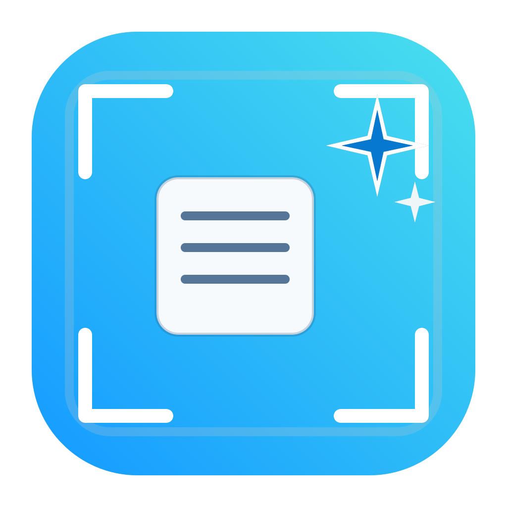

# ClipWise - 截图智读助手

<div align="center">



**截图后调用本地视觉语言模型进行翻译、OCR 和智能总结**

[](https://swift.org)
[](https://www.apple.com/macos)
[](LICENSE)

[English](#english) | [中文](#中文)

</div>

---

## 中文

### 📖 简介

ClipWise（截图智读助手）是一个 macOS 原生截图工具，截图后可调用本地视觉语言模型（VLM）进行：

- **英文翻译** - 识别图片中的英文文字并翻译为自然准确的中文
- **OCR 原文提取** - 完整识别图片中的文字，保持原文语言和段落结构
- **AI 智能总结** - 用中文概括图片文字的核心意思，帮助快速理解

支持 OpenAI 兼容的本地 API（如 LM Studio、Ollama 等），无需联网，隐私安全。

### ✨ 功能特性

| 功能 | 描述 |
|------|------|
| 🖼️ **原生截图** | AppKit 全屏选区截图，支持 Retina 和多显示器 |
| ⌨️ **全局快捷键** | 默认 `Control + Shift + A`，窗口隐藏/最小化时仍可触发 |
| 🤖 **本地 VLM** | 支持 OpenAI 兼容 API，默认 `http://127.0.0.1:1234` |
| 🔄 **模型管理** | 多模型配置，快速切换不同模型 |
| ✏️ **自定义动作** | 自定义 AI 动作（翻译/OCR/总结等），支持 SF Symbol 或自定义图标 |
| 🔒 **隐私保护** | 截图时可隐藏 ClipWise 窗口，避免被截入画面 |
| 📋 **一键复制** | AI 结果一键复制到剪贴板 |
| 💾 **快速保存** | 截图一键保存到指定目录 |
| 📍 **状态栏** | 菜单栏常驻图标，快速访问主界面 |

### 🏗️ 项目架构

```
ClipWise
├── SnipConcludeMac/          # macOS 原生版本（主维护方向）
│   ├── Package.swift         # Swift Package 清单
│   ├── Assets/               # 图标资源
│   │   ├── ClipWise.icns     # 应用图标
│   │   └── ClipWise.iconset/ # iconset 源文件
│   └── Sources/
│       ├── main.swift              # 应用入口
│       ├── AppDelegate.swift       # 应用生命周期、状态栏、热键、截图流程
│       ├── AppSettings.swift       # 设置模型与持久化
│       ├── MainSettingsView.swift  # 设置窗口（SwiftUI）
│       ├── ResultWindowController.swift # 结果窗口（主窗口）
│       ├── ScreenshotController.swift    # 截图选区与捕获
│       ├── HotkeyMonitor.swift     # 全局快捷键（CGEvent Tap）
│       ├── OpenAICompatibleClient.swift  # AI API 客户端
│       └── CaptureResult.swift     # 截图数据容器
├── snipconclude/             # Python/PySide6 跨平台版本（原型）
│   ├── app.py                # 应用控制器
│   ├── settings.py           # 设置模型
│   ├── capture.py            # 截图辅助
│   ├── hotkeys.py            # 全局快捷键
│   ├── workers.py            # AI 请求后台工作器
│   └── ui/                   # UI 模块
├── scripts/
│   ├── generate_icons.swift  # 图标生成脚本
│   └── package_app.sh        # 打包脚本
└── README.md
```

### 🛠️ 技术栈

**macOS 原生版本：**
- Swift 6 + SwiftUI + AppKit
- CGEvent Tap 全局热键监听
- CGWindowListCreateImage 截图捕获
- OpenAI 兼容 HTTP API
- JSON 设置持久化

**Python 原型版本：**
- Python + PySide6
- mss 截图库
- pynput 全局热键
- openai SDK

### 🚀 快速开始

#### 运行 macOS 原生版本

```bash
cd SnipConcludeMac
swift build
swift run ClipWiseMac
```

或用 Xcode 打开 `Package.swift` 运行。

#### 打包测试版

```bash
./scripts/package_app.sh
```

产物：
- `dist/ClipWise.app`
- `dist/ClipWise.zip`

#### 运行 Python 原型版本

```bash
pip install PySide6 mss pynput openai pillow pyperclip
python snip_conclude.py
```

### ⚙️ 配置

设置存储位置：
- macOS: `~/Library/Application Support/ClipWise/settings.json`
- Python: `~/.clipwise/settings.json`

默认配置：
- API 地址: `http://127.0.0.1:1234`
- 默认模型: `qwen/qwen3.6-27b`
- API Key: 可为空（本地服务）

### 🔐 权限要求

| 权限 | 用途 |
|------|------|
| **屏幕录制** | 截图功能需要 |
| **辅助功能** | 全局快捷键监听需要 |

首次运行时 macOS 会提示授权。

### 📸 截图预览

> 截图功能演示（待补充）

### 👤 作者信息

- **开发者**: @Pilot.Phil
- **邮箱**: wenbodong@sjtu.edu.cn
- **项目主页**: [GitHub Repository](https://github.com/pilotphil/clipwise)

### 📄 许可证

本项目采用 MIT 许可证，详见 [LICENSE](LICENSE) 文件。

---

## English

### 📖 Introduction

ClipWise (Screenshot AI Assistant) is a native macOS screenshot tool that calls local Vision-Language Models (VLM) for:

- **English Translation** - Recognize English text in images and translate to natural Chinese
- **OCR Text Extraction** - Fully recognize text in images, preserving original language and structure
- **AI Smart Summary** - Summarize the core meaning of image text in Chinese for quick understanding

Supports OpenAI-compatible local APIs (LM Studio, Ollama, etc.) - no internet required, privacy secure.

### ✨ Features

| Feature | Description |
|---------|-------------|
| 🖼️ **Native Screenshot** | AppKit full-screen selection, supports Retina and multi-display |
| ⌨️ **Global Hotkey** | Default `Control + Shift + A`, works even when window is hidden/minimized |
| 🤖 **Local VLM** | OpenAI-compatible API support, default `http://127.0.0.1:1234` |
| 🔄 **Model Management** | Multiple model profiles, quick switching |
| ✏️ **Custom Actions** | Custom AI actions (translate/OCR/summarize), SF Symbol or custom icons |
| 🔒 **Privacy Protection** | Hide ClipWise windows during screenshot capture |
| 📋 **One-click Copy** | Copy AI results to clipboard instantly |
| 💾 **Quick Save** | Save screenshots to specified directory |
| 📍 **Status Bar** | Menu bar icon for quick access |

### 🏗️ Architecture

```
ClipWise
├── SnipConcludeMac/          # macOS Native Version (Primary)
│   ├── Package.swift         # Swift Package Manifest
│   ├── Assets/               # Icon Resources
│   └── Sources/              # Swift Source Code
├── snipconclude/             # Python/PySide6 Version (Prototype)
├── scripts/                  # Build Scripts
└── README.md
```

### 🛠️ Tech Stack

**macOS Native:**
- Swift 6 + SwiftUI + AppKit
- CGEvent Tap global hotkey
- CGWindowListCreateImage screenshot
- OpenAI-compatible HTTP API

**Python Prototype:**
- Python + PySide6
- mss, pynput, openai SDK

### 🚀 Quick Start

```bash
# macOS Native
cd SnipConcludeMac
swift build
swift run ClipWiseMac

# Package test build
./scripts/package_app.sh
```

### 🔐 Permissions Required

| Permission | Purpose |
|------------|---------|
| **Screen Recording** | Required for screenshot |
| **Accessibility** | Required for global hotkey |

### 👤 Author

- **Developer**: @Pilot.Phil
- **Email**: wenbodong@sjtu.edu.cn

### 📄 License

MIT License - see [LICENSE](LICENSE) file.

---

<div align="center">

**Made with ❤️ by Pilot.Phil**

</div>